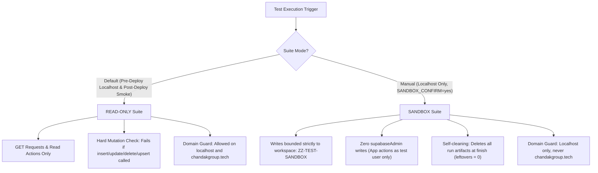

# Testing Architecture & Data Isolation Governance (`TEST_MODES.md`)

This authoritative document defines the two isolated testing modes running against localhost (`.env.local`) and the live environment without an external UAT project, providing absolute data isolation and zero impact on production operations.

---

## 1. Core Architecture: The Two Testing Modes

Testing is bifurcated into two mutually exclusive suites with distinct safety boundaries:

### A. READ-ONLY Suite (Default, Pre-Deploy & Post-Deploy Smoke)
- **Execution Target**: Localhost verification before every deploy, automated CI safety gate (post-approval), and production smoke verification on `https://chandakgroup.tech`.
- **Allowed Operations**: `GET` HTTP requests against pages/APIs, and read-only queries as authenticated test users.
- **Mutation Guard**: A runtime assertion fails the run immediately if any read-only test calls `insert()`, `update()`, `delete()`, `upsert()`, or a mutating Server Action.
- **Domain Guard**: Permitted on `http://localhost:3000` and `https://chandakgroup.tech`.
- **Service Role Block**: Static pre-flight gate guarantees zero baseline files import `lib/supabase/service_role`.

### B. SANDBOX Suite (Manual Localhost Only)
- **Execution Trigger**: `npm run test:sandbox` (Strictly requires environment variable `SANDBOX_CONFIRM=yes`).
- **Domain Guard**: Localhost only (`http://localhost:3000`). Strictly barred from running against `https://chandakgroup.tech`.
- **Enclosure Boundary**: All mutations are permitted **exclusively** inside the dedicated test workspace `ZZ-TEST-SANDBOX`.
- **Authentic App Mutations**: Zero tests use `supabaseAdmin` for writes; all mutations must flow through the application's actual Server Actions or API routes under an authenticated test user session.
- **Self-Cleaning Guarantee**: The suite registers every entity created during the run, purges them upon completion, and reports any leftover artifacts (must report leftovers = 0).
- **CI Exclusion**: The sandbox suite **never** runs in automated CI workflows.

---

## 2. Test Account Security & Role Matrix

All test accounts reuse identities from the 28 pre-existing test accounts, with strict restrictions:

### A. Active Accounts (18 Total)
- **STANDARD Users (1 per module)**:
  - `test.task.standard@chandakgroup.tech`
  - `test.ticket.standard@chandakgroup.tech`
  - `test.req.standard@chandakgroup.tech`
  - `test.design.viewer@chandakgroup.tech`
  - `test.vehicle.traveler@chandakgroup.tech`
  - `test.meet.attendee@chandakgroup.tech`
  - `test.budget.viewer@chandakgroup.tech`
  - `test.amc.standard@chandakgroup.tech`
- **No-Access Users (1 per module)**:
  - `test.task.noaccess@chandakgroup.tech`
  - `test.ticket.noaccess@chandakgroup.tech`
  - `test.req.noaccess@chandakgroup.tech`
  - `test.design.noaccess@chandakgroup.tech`
  - `test.vehicle.noaccess@chandakgroup.tech`
  - `test.meet.noaccess@chandakgroup.tech`
  - `test.budget.noaccess@chandakgroup.tech`
  - `test.amc.noaccess@chandakgroup.tech`
  - `test.dash.noaccess@chandakgroup.tech`
- **Dashboard Viewers**:
  - `test.dash.viewer@chandakgroup.tech` (IT Dashboard Only)
  - `test.dash.multi@chandakgroup.tech` (IT + Engineering Dashboards)

### B. Permanently Banned Accounts (9 Total)
- `test.superadmin@chandakgroup.tech` — **PERMANENTLY BANNED**. There is zero Super Admin test account. All Super Admin test cases are classified as `MANUAL`.
- `test.task.manager@chandakgroup.tech`
- `test.ticket.lead@chandakgroup.tech`
- `test.req.lead@chandakgroup.tech`
- `test.design.lead@chandakgroup.tech`
- `test.vehicle.admin@chandakgroup.tech`
- `test.meet.organizer@chandakgroup.tech`
- `test.budget.admin@chandakgroup.tech`
- `test.amc.admin@chandakgroup.tech`

### C. Account Safeguards
1. **Identification**: Test accounts carry `is_test_user = true` (additive column on `user_master`).
2. **Credential Security**: Credentials derive exclusively from `TEST_USER_PASSWORD` (configured in GitHub Secrets and local environment; never committed or hard-coded).
3. **Strict Scoping**: Module access for test accounts is scoped **exclusively** to `ZZ-TEST-SANDBOX` (`scope_type = 'SPECIFIC'`, `scope_ids = ['ZZ-TEST-SANDBOX']`). They hold zero access to real client workspaces, projects, or live operational records.

---

## 3. Strict Production Data Isolation (Zero Contamination)

To guarantee that real business operations, analytics, and metrics remain pristine:

1. **Record Tagging**: Any record generated within the sandbox workspace carries `is_test = true`.
2. **Analytical Exclusion**:
   - Executive Dashboards, KPI cards, and trend charts filter out `is_test = true` records and `is_test_user` accounts.
   - Global search, My Work views, and CSV/Excel exports strictly exclude `is_test = true` entities.
   - SLA tracking and TAT escalation cron jobs explicitly ignore test records.
3. **Notification Firewall**:
   - Zero outbound emails or web-push notifications are delivered to `test.*@chandakgroup.tech` addresses.
   - Actions performed by test accounts cannot trigger notifications to real users.

---

## 4. Remediation & Transition Plan for Earlier Run Artifacts

The live database audit identified the following fixed test artifacts:
- **Tasks**: `TSK-TEST-ALPHA` (`cab68c35-...`), `SUB-TEST-ALPHA` (`2f962064-...`)
- **Tickets**: `TCK-TEST-ALPHA` (`5ad65aee-...`)
- **Requirements**: `REQ-TEST-ALPHA` (`79b6e53b-...`)
- **Real Records Affected**: **0** (confirmed by SELECT audit).

### Transition Strategy (Awaiting Project Owner OK)
1. Initialize the dedicated sandbox workspace `ZZ-TEST-SANDBOX`.
2. Re-parent and link the fixed entities (`TSK-TEST-ALPHA`, `SUB-TEST-ALPHA`, `TCK-TEST-ALPHA`, `REQ-TEST-ALPHA`) to `ZZ-TEST-SANDBOX` with `is_test = true`.
3. Retain them as persistent fixtures for manual sandbox validation.
4. Execute no update or migration until explicit user confirmation is received.

---

## 5. Standard Workflow for Every Code Change

Every modification follows a 4-step gate before reaching production:

1. **Step 5.1: Pre-Deploy Localhost READ-ONLY Suite**:
   - Start localhost with `-H localhost` (`npm run dev -- -H localhost` or `npm run build && npm run start`).
   - Run READ-ONLY suite against `http://localhost:3000`. Must pass 100%.
2. **Step 5.2: Pre-Deploy Localhost SANDBOX Suite** (If mutation affected):
   - If the change modifies create, edit, delete, approve, or priority logic, run `npm run test:sandbox` on localhost with `SANDBOX_CONFIRM=yes`.
   - Must pass 100% and report leftover entities = 0.
3. **Step 5.3: Commit & Push to `develop`**:
   - Commit changes on `develop`. Fast-forward merge to `main` and deploy **strictly when owner says "deploy"**.
4. **Step 5.4: Post-Deploy Production READ-ONLY Smoke**:
   - Probe `https://chandakgroup.tech`:
     * `/api/version` returns commit = deployed SHA.
     * `serverBootTime` is newer than deploy trigger time.
     * `/login` latency < 3.0s.
     * Module pages open with valid content.
     * No-access test user denied.

---

## 6. CI Safety Gate & Known Bugs Governance

- **CI Scope**: The CI pipeline executes the **READ-ONLY suite only**. The SANDBOX suite never runs in CI.
- **Known Bugs Registry**: `docs/tests/KNOWN_BUGS.md` is an authoritative, hand-approved committed list. The automated runner **never** rewrites it.
- **Regression Lock**: Any unexpected failure on a test not listed in `KNOWN_BUGS.md` halts the build and blocks deployment.
- **Test Case Classification**:
  - **PASS**: Real assertion passed against the app.
  - **FAIL**: Real assertion failed; cataloged in `KNOWN_BUGS.md`.
  - **MANUAL**: Requires Super Admin rights, multi-party physical flow, or third-party interaction. **Never reported as PASS.**
