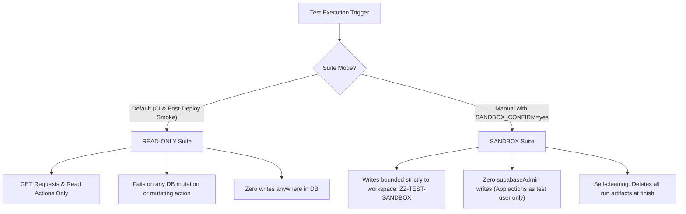

# Testing Architecture & Data Isolation Governance (`TEST_MODES.md`)

This authoritative document defines the two isolated testing modes running against localhost and the live environment without an external UAT project, providing absolute data isolation and zero impact on production operations.

---

## 1. Core Architecture: The Two Testing Modes

Testing is bifurcated into two mutually exclusive suites with distinct safety constraints:

### A. READ-ONLY Suite (Default, CI & Post-Deploy)
- **Execution Target**: PR governance, scheduled CI, and post-deploy production smoke.
- **Allowed Actions**: `GET` HTTP requests against pages/APIs, and read-only server queries as authenticated test users.
- **Mutation Block**: A runtime interceptor fails any test immediately if it calls `insert()`, `update()`, `delete()`, `upsert()`, or a mutating Server Action.
- **Service Role Block**: Static pre-flight gate guarantees zero baseline files import `lib/supabase/service_role`.

### B. SANDBOX Suite (Manual Execution Only)
- **Execution Trigger**: `npm run test:sandbox` (Strictly requires `SANDBOX_CONFIRM=yes`).
- **Enclosure Boundary**: All writes are permitted **exclusively** inside the dedicated workspace `ZZ-TEST-SANDBOX`.
- **Authentic App Mutations**: No test anywhere uses `supabaseAdmin` for writes; all mutations must flow through the application's actual Server Actions or API routes under an authenticated test user session.
- **Self-Cleaning Guarantee**: The suite tracks every entity created during the run, purges them upon completion, and reports any leftover artifacts.
- **CI Exclusion**: The sandbox suite **never** runs in automated CI workflows.

---

## 2. Test Account Security & Role Matrix

All test accounts reuse identities from the 28 pre-existing test accounts, with strict restrictions:

### A. Active vs Permanently Banned Accounts
- **Permanently Banned**: `test.superadmin@chandakgroup.tech` remains banned. All Super Admin test cases are classified as `MANUAL` and are never executed by automated runners.
- **Unbanned for Testing**:
  - One `STANDARD` user per module
  - One `noaccess` user per module
  - `test.dash.viewer@chandakgroup.tech` (Single Dashboard Viewer)
  - `test.dash.multi@chandakgroup.tech` (Multi Dashboard Lead)
  - All other test accounts remain banned.

### B. Account Safeguards
1. **Identification**: Test accounts carry `is_test_user = true` (additive column on `user_master`).
2. **Credential Security**: Credentials derive exclusively from `TEST_USER_PASSWORD` (configured in GitHub Secrets and local environment; never committed or hard-coded).
3. **Strict Scoping**: Module access for test accounts is scoped **exclusively** to `ZZ-TEST-SANDBOX` (`scope_type = 'SPECIFIC'`, `scope_ids = ['ZZ-TEST-SANDBOX']`). They hold zero access to real client workspaces, projects, or live operational records.

---

## 3. Strict Production Data Isolation (Zero Contamination)

To guarantee that real business operations, analytics, and metrics remain pristine:

1. **Record Tagging**: Any record generated within the sandbox workspace carries `is_test = true`.
2. **Analytical Exclusion**:
   - Executive Dashboards, KPI cards, and trend charts filter out `is_test = true` records and `is_test_user` accounts.
   - Global search, My Work views, and CSV/Excel exports strictly exclude `is_test = true` entities.
   - SLA tracking and TAT escalation cron jobs explicitly ignore test records.
3. **Notification Firewall**:
   - Zero outbound emails or web-push notifications are delivered to `test.*@chandakgroup.tech` addresses.
   - Actions performed by test accounts cannot trigger notifications to real users.

---

## 4. Remediation & Transition Plan for Earlier Run Artifacts

The live database audit identified the following fixed test artifacts:
- **Tasks**: `TSK-TEST-ALPHA` (`cab68c35-...`), `SUB-TEST-ALPHA` (`2f962064-...`)
- **Tickets**: `TCK-TEST-ALPHA` (`5ad65aee-...`)
- **Requirements**: `REQ-TEST-ALPHA` (`79b6e53b-...`)
- **Real Records Affected**: **0** (confirmed by SELECT audit).

### Transition Strategy (Awaiting Project Owner OK)
1. Initialize the dedicated sandbox workspace `ZZ-TEST-SANDBOX`.
2. Re-parent and link the fixed entities (`TSK-TEST-ALPHA`, `SUB-TEST-ALPHA`, `TCK-TEST-ALPHA`, `REQ-TEST-ALPHA`) to `ZZ-TEST-SANDBOX` with `is_test = true`.
3. Retain them as persistent fixtures for manual sandbox validation.
4. Execute no update or migration until explicit user confirmation is received.

---

## 5. Test Status Classification

Per governance rules, test cases in [TEST_CASES.md](file:///d:/adios/docs/tests/TEST_CASES.md) and reports are classified as:
- **PASS**: Real assertion succeeded against the app in the appropriate suite.
- **FAIL**: Real assertion failed; defect recorded in [KNOWN_BUGS.md](file:///d:/adios/docs/tests/KNOWN_BUGS.md).
- **MANUAL**: Test requires Super Admin privileges, physical multi-party workflows, or external third-party interaction. **Never counted as PASS in automated summaries.**
